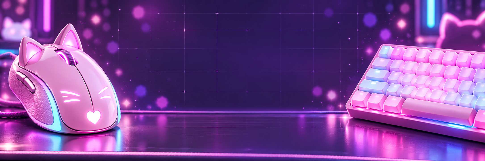
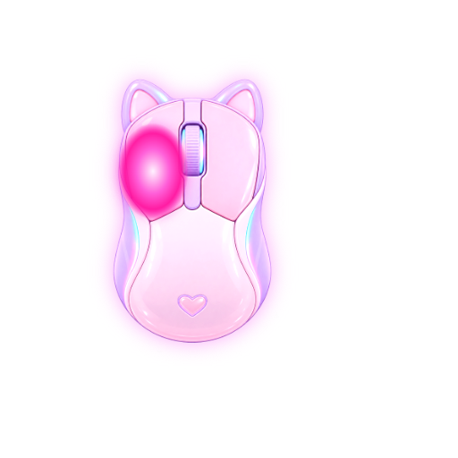
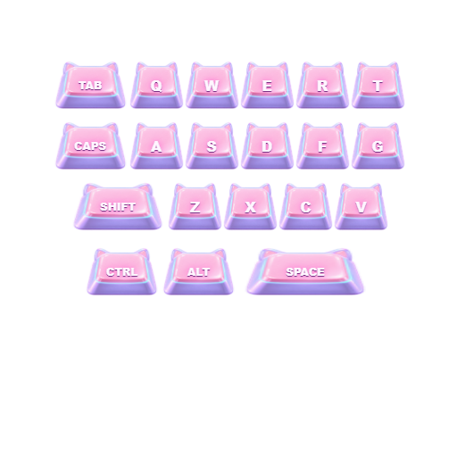

<p align="center">
  
</p>

<p align="center">
  <b>Cute live mouse, keyboard and music overlays for OBS.</b><br>
  One portable Windows app · transparent Browser Sources · no installer.
</p>

<p align="center">
  
  
  
</p>

## Preview

<p align="center">
  
  
</p>

These are screenshots from the running local overlay pages. The mouse follows the real pointer inside a soft safe area; the keyboard responds to `Tab Q W E R T`, `Caps A S D F G`, `Shift Z X C V`, and `Ctrl Alt Space`.

## Download and run

Every push to `main` runs GitHub Actions and publishes a GitHub Release with one file named `PickMe-Overlay-*-portable.exe`.

1. Download the portable `.exe` from the repository's **Releases** page.
2. Run it — there is no installer.
3. Keep its small status window open while streaming. It confirms that the local overlay server is running.

## OBS setup

Add Browser Source entries. Use **width `512`** and **height `512`** for mouse and keyboard; music uses **width `512`** and **height `162`**.

| Source | URL |
| --- | --- |
| Mouse | `http://127.0.0.1:31337/overlay/` |
| Keyboard | `http://127.0.0.1:31337/keyboard/` |
| Music | `http://127.0.0.1:31337/music/` |

Enable **Refresh browser when scene becomes active** for each source.

> [!IMPORTANT]
> In each Browser Source’s **Properties**, delete everything from **Custom CSS** — leave the field completely empty. OBS supplies default CSS in this field; it can add a background, spacing, or break the transparent composition.

## Music and settings

The app opens a settings window at launch with a live music preview. Pick **Auto**, **Spotify**, or **Other player**, plus the PickMe or dark skin. The system source reads Windows’ active media session, so it supports Spotify, browser players, and other compatible apps without a token or a Spotify login. It provides the real cover, track title, artist, playback progress and status.

## Build from source

Requires Node.js 22+.

```powershell
npm ci
npm run desktop       # run the status window locally
npm run dist          # create a one-file portable EXE in dist/
```

## Skins

Mouse and keyboard assets live in `skins/`. Duplicate a skin folder and replace its PNGs to make a new theme. The renderer composes mouse-button states, so left, right, middle, and combined clicks remain distinct without requiring a PNG for every combination.

## License

[MIT](LICENSE)
